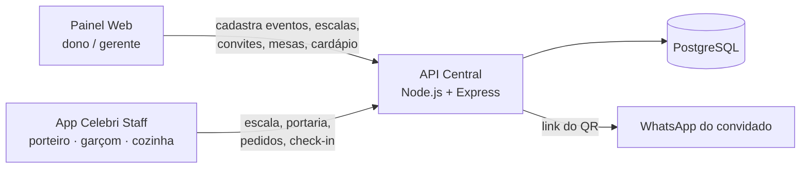
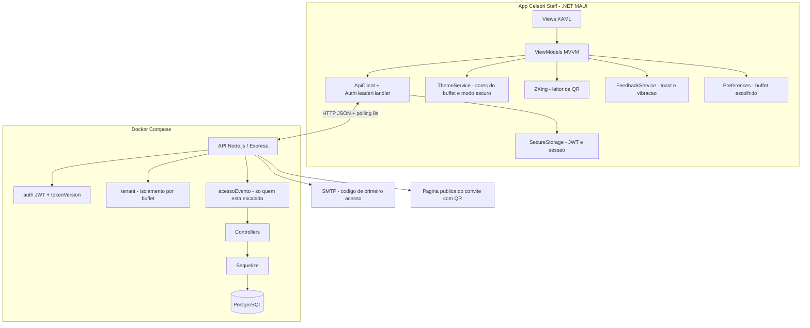
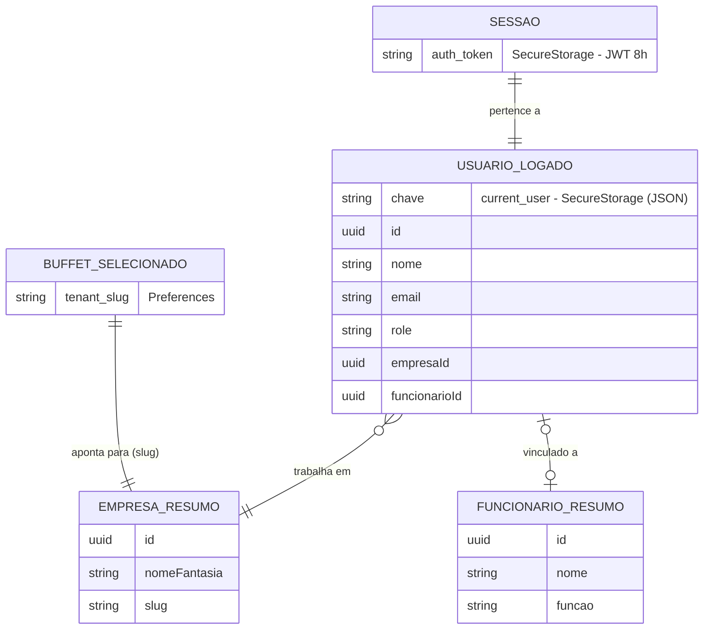
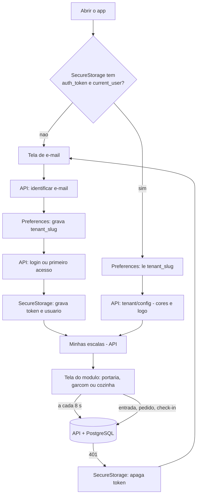
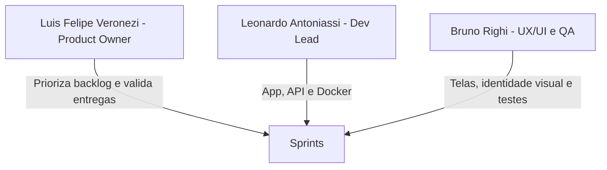
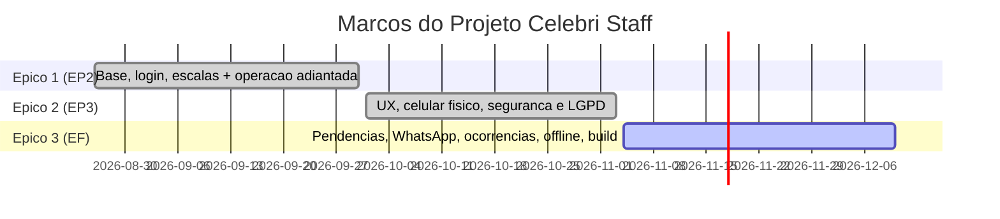
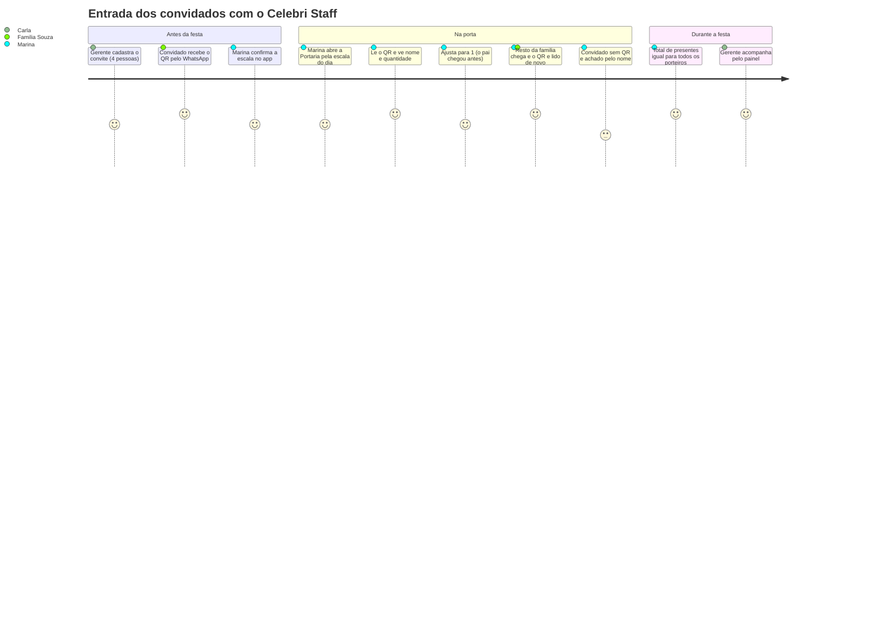

# PROJETO ÁGIL DE SOFTWARE
## Aplicativo Móvel: Celebri Staff — o app da equipe do buffet no dia da festa

> **Em uma frase:** o **Celebri Staff** é o aplicativo Android que os funcionários de um buffet usam **durante o evento**. Cada um entra só com o e-mail, vê suas escalas e abre a tela da sua função:
> - **portaria:** contador de pessoas e leitura do QR code do convite;
> - **garçom:** mapa de mesas e comanda;
> - **cozinha:** pedidos, cardápio com horários e estoque.
>
> Tudo aparece com a marca e as cores do buffet contratante.

---

## SEÇÃO PRÉ-TEXTUAL

### Histórico de revisão

| Data | Versão | Descrição das Alterações | Autor(es) |
| :---: | :---: | :--- | :--- |
| 26/08/2026 | 1.0 | Plano de Projeto Ágil do App Mobile: Canvas, arquitetura, backlog US01–US07, cronograma de 6 sprints, DoR/DoD e riscos. | Luis Felipe Veronezi (PO), Leonardo Antoniassi (Dev), Bruno Righi (UX/QA) |
| 30/09/2026 | 2.0 | **Projeto Ágil do Aplicativo (Marco 1 / EP2).** Evolução da ideia e refinamentos, visão/escopo/limitações atualizados, funcionalidades por perfil, backlog com status, épicos replanejados, Épico 1 proposto × realizado, desafios, próximos passos, Jornada do Usuário (portaria) e Tratamento de Dados/LGPD. | Luis Felipe Veronezi (PO), Leonardo Antoniassi (Dev), Bruno Righi (UX/QA) |
| 03/11/2026 | 3.0 | **Marco 2 / EP3.** Funcionalidades características de aplicativo, **arquitetura da camada de dados** (armazenamento local × nuvem/API, modelo local e diagramas), backlog e épicos com status atualizado, review do Épico 1 com resolução de pendências, **Épico 2: descrição, proposto × realizado**, desafios, próximos passos até o EF e LGPD atualizada. | Luis Felipe Veronezi (PO), Leonardo Antoniassi (Dev), Bruno Righi (UX/QA) |

### Sumário
1. Introdução — contexto, equipe, stack e **evolução da ideia**
2. O Aplicativo — visão, funcionalidades, **funcionalidades características de app**, escopo e limitações, arquitetura e **camada de dados**
3. Projeto Ágil — backlog com status, marcos/épicos, **review do Épico 1**, **Épico 2 proposto × realizado**, desafios, próximos passos
4. Jornada do Usuário — Portaria com QR code
5. Tratamento de Dados e LGPD
6. Guia de Execução e Testes

---

# 1. INTRODUÇÃO

### 1.1 Apresentação do Documento
Este documento é o **Projeto Ágil do Aplicativo Celebri Staff**, do Projeto Integrador do 5º semestre do curso de Desenvolvimento de Software Multiplataforma. Ele registra a situação real do projeto no **Marco 2 (EP3)**:
- o que foi refinado;
- o que foi entregue em cada épico;
- como o app trata os dados;
- o que falta até a entrega final (EF).

O Celebri Staff faz parte do **Celebri**, uma plataforma **SaaS B2B multilocatária (White Label)** de gestão de buffets e eventos. O painel web (já existente) é usado pelo dono ou gerente do buffet. O app é usado pela **equipe operacional no salão**: recepcionistas/porteiros, garçons e cozinha.

### 1.2 Contexto de Negócio: Business Model Canvas

| Bloco do Canvas | Descrição |
| :--- | :--- |
| **Parcerias-Chave** | Provedores de nuvem, serviço de e-mail transacional (SMTP), WhatsApp (links `wa.me`), Google Play Store. |
| **Atividades-Chave** | Evolução da API REST, manutenção do app multiplataforma, identidade visual dinâmica por buffet, infraestrutura em Docker. |
| **Recursos-Chave** | API Node.js/Express, PostgreSQL, app .NET MAUI, painel React, equipe de desenvolvimento. |
| **Proposta de Valor** | O buffet opera a festa inteira pelo celular — escala, portaria, garçom e cozinha — com a própria marca, sem listas de papel nem recados de boca. |
| **Relacionamento com Clientes** | Onboarding do buffet, autosserviço no painel web, suporte direto. |
| **Canais** | Painel web, app Android, WhatsApp para convites e contato. |
| **Segmento de Clientes** | Buffets infantis, casas de festas, espaços de casamento/formatura e cerimoniais. |
| **Estrutura de Custos** | Hospedagem e banco de dados, publicação na loja, esforço de engenharia. |
| **Fontes de Receita** | Assinatura mensal/anual por plano (volume de festas ou número de salões) e taxa de onboarding/personalização. |

### 1.3 O App no Ecossistema Celebri



* **Painel web:** o gerente prepara o evento — funcionários, escala, lista de convidados, mesas do salão e cardápio da cozinha.
* **API central:** regras de negócio, autenticação JWT, isolamento entre buffets (multi-tenant) e persistência.
* **App Celebri Staff:** a operação no dia da festa, a partir desses dados.

### 1.4 Motivação
A operação de uma festa é rápida e barulhenta. Hoje o buffet depende de:
- lista de convidados em papel;
- contagem "de cabeça" na porta;
- garçom indo e voltando da cozinha para perguntar;
- escala combinada por mensagem.

O app resolve isso com:
1. **Mobilidade:** cada funcionário trabalha do próprio celular, no salão.
2. **Portaria sem papel:** QR code do convite e contador de pessoas compartilhado entre porteiros.
3. **Garçom ↔ cozinha sem ruído:** o pedido anotado na mesa aparece na tela da cozinha, e o garçom vê quando fica pronto.
4. **Diferencial White Label:** o app aparece com a marca do buffet para a equipe.

### 1.5 Equipe L2Tech
* **Luis Felipe Veronezi** — *Product Owner*: visão do produto, priorização do backlog, validação das entregas.
* **Leonardo Antoniassi** — *Desenvolvedor Fullstack (Dev Lead)*: arquitetura, app, API e Docker.
* **Bruno Righi** — *UX/UI & QA*: interfaces, experiência do usuário, identidade visual dinâmica e testes.

### 1.6 Repositórios Git
* **App móvel (Celebri Staff):** [github.com/leoantoniassi/celebri-staff](https://github.com/leoantoniassi/celebri-staff)
* **Painel web + API central (Celebri):** [github.com/leoantoniassi/celebri](https://github.com/leoantoniassi/celebri)

### 1.7 Stack Definida

| Camada | Tecnologia |
| :--- | :--- |
| App | **.NET MAUI (.NET 10)**, CommunityToolkit.Mvvm, CommunityToolkit.Maui (toasts/snackbars), **ZXing.Net.Maui** (leitor de QR), `SecureStorage` e `Preferences` (dados locais) |
| Alvo | **Android** (emulador e aparelho). iOS fica fora do semestre (exige macOS). |
| API | Node.js 22 + Express, Sequelize, JWT, bcrypt, `qrcode` |
| Banco | PostgreSQL 15 (Docker), migrations SQL versionadas |
| Painel web | React + Vite + Tailwind |
| Infra | Docker Compose; CI com GitHub Actions, CodeQL e Dependabot |

### 1.8 Evolução da Ideia

**Ponto de partida.** O grupo começou com um sistema web sob medida para **um** buffet ("Celebri", depois "Festify"). Depois o sistema virou um **SaaS White Label** (renomeado **Celebri**), em que cada buffet assinante usa a própria marca.

O Plano de Projeto v1.0 previa um app com 7 histórias genéricas:
- login com **código da empresa**;
- escalas;
- portaria com QR;
- catraca digital;
- WhatsApp;
- fotos de ocorrências;
- modo offline.

**Refinamentos do Marco 1 (Épico 1):**

| # | Refinamento | Por quê |
| :-: | :--- | :--- |
| 1 | **Telas por função**: portaria, garçom e cozinha (antes era um app genérico). | O grupo definiu o que cada função precisa no salão; cada funcionário vê só o que usa. |
| 2 | **Portaria:** contador de pessoas + QR que vale para **1 ou N pessoas** (família), com **quantidade editável** e **lista de convidados opcional** por evento. | Famílias chegam em momentos diferentes; nem todo buffet trabalha com lista. |
| 3 | **Garçom:** mapa de mesas, comanda e anotações — **sem cobrança**. | Em buffet a comida é inclusa; a comanda serve para **pedir à cozinha**, não para cobrar. |
| 4 | **Cozinha:** o que será servido, quantidade, horário previsto e estoque. | Substitui o papel colado na parede e junta com os pedidos dos garçons. |
| 5 | **Login só com e-mail.** O dono cadastra o e-mail do funcionário. No primeiro acesso, o app descobre o buffet e o funcionário cria a senha **depois de digitar um código de 6 dígitos enviado por e-mail**. | Mais simples que digitar o código da empresa. O código foi incluído porque, sem ele, qualquer pessoa que soubesse o e-mail poderia criar a senha e tomar a conta. |
| 6 | **Função por escala** e **módulo do app por função**. | A mesma pessoa pode ser garçom num evento e porteiro em outro; cada buffet dá nomes próprios às funções. |
| 7 | **Intervalo mínimo entre escalas configurável** por buffet (antes fixo em 2h). | Pedido do grupo: cada buffet tem sua regra de descanso entre eventos. |
| 8 | **Conta de login ligada ao funcionário** (`usuarios` ↔ `funcionarios`). | Reaproveita o login seguro já existente em vez de criar um segundo sistema. |
| 9 | **Stack .NET MAUI** (Flutter descartado). | Afinidade da equipe com C# e Visual Studio. |

**Refinamentos do Marco 2 (Épico 2):**

| # | Refinamento | Por quê |
| :-: | :--- | :--- |
| 10 | **Design system próprio do app:** paleta Celebri, **modo claro/escuro**, ícones Material e componentes reutilizáveis (cabeçalho com a marca, estado vazio, faixa de erro, seletor de quantidade, etiqueta de situação). | As telas do Épico 1 eram funcionais, mas cada uma tinha um visual. No salão (pouca luz, pressa) o funcionário precisa reconhecer o estado de relance. |
| 11 | **Feedback de app:** toast de sucesso com **vibração**, snackbar de erro e **skeleton** no carregamento. | O funcionário precisa saber, sem ler, que a entrada ou o pedido foi registrado. |
| 12 | **Uso no celular real pelo cabo USB** (`adb reverse`), sem depender do IP do computador. | O IP mudava a cada rede e travava os testes em aparelho físico. |
| 13 | **Prioridade para segurança e LGPD antes de novas telas.** | Antes de pôr o app em uso real com dados de convidados, a API precisava estar pronta para isso: revogação de sessão, autorização do funcionário de campo, auditoria, anonimização. |
| 14 | **Contador adulto/criança, cronograma com avisos e atalho do gerente** passam para o EF. | Consequência do item 13: o esforço do épico foi para UX e segurança. |

---

# 2. O APLICATIVO

### 2.1 Visão do Produto
> *"Para buffets e salões de festas que precisam de controle na execução dos eventos, o **Celebri Staff** é o aplicativo da equipe do salão: cada funcionário entra com o e-mail, confirma suas escalas e, no dia da festa, usa a tela da sua função — portaria com QR code e contador, comanda do garçom para a cozinha e painel da cozinha com cardápio e estoque. Diferente de listas de papel e recados, tudo fica sincronizado entre os funcionários, com a marca do buffet."*

### 2.2 Funcionalidades do App (o que será entregue no PI)

| Perfil | O que faz no app | Situação |
| :--- | :--- | :---: |
| **Todos** | Entrar só com o e-mail (o app descobre o buffet). Primeiro acesso com código de 6 dígitos e criação de senha. Identidade visual do buffet (cores, logo, nome). | ✅ |
| **Todos** | **Minhas escalas:** próximos eventos e anteriores, com função e local. **Confirmar ou recusar** presença. **"Cheguei no evento"** (check-in, de 3h antes até o fim). | ✅ |
| **Todos** | Visual padronizado, **modo escuro**, feedback com vibração e toasts, carregamento com skeleton. | ✅ (Épico 2) |
| **Porteiro / recepção** | **Contador de pessoas** (+1 / −1) compartilhado entre porteiros. **Leitura do QR** do convite com nome e quantidade, **lanterna** no leitor. **Entrada parcial** e correção. Busca do convidado pelo nome. | ✅ |
| **Garçom** | **Mapa das mesas** do salão com a situação de cada uma (livre / aguardando cozinha / pronto). **Comanda** com itens, quantidade, anotação e alerta de alergia. Marcar entregue ou cancelar. | ✅ |
| **Cozinha** | **Pedidos** dos garçons por ordem de chegada (começar / pronto). **Cardápio** com o que será servido, quantidade e horário previsto. **Estoque** reservado ao evento com alerta de mínimo. | ✅ |
| Porteiro | Contador separado de adultos e crianças com barra de lotação. | 📅 EF |
| Todos | Cronograma do evento com avisos de horário. | 📅 EF |
| Gerente | Atalho para abrir portaria, garçom e cozinha sem estar escalado. | 📅 EF |
| Todos | Contato por WhatsApp em 1 toque; foto de ocorrências; modo offline. | 📅 EF |

**No painel web** (repositório `celebri`), o gerente prepara o que o app usa:
- funcionário com e-mail (cria a conta do app);
- função com o **módulo do app**;
- escala com **função por evento**;
- **intervalo mínimo** entre escalas;
- **lista de convidados** com envio do QR pelo WhatsApp;
- **mapa de mesas** por salão;
- **cardápio da cozinha** por evento.

### 2.3 Funcionalidades Características de Aplicativo

O Celebri Staff é um **app nativo Android** (.NET MAUI compila para um APK com interface nativa). Não é um site aberto no celular: as funcionalidades abaixo usam recursos do aparelho que uma página web não teria, ou teria de forma limitada.

| Recurso | Como o app usa | Onde está no código |
| :--- | :--- | :--- |
| **Câmera nativa + leitura de QR** | A portaria aponta a câmera para o convite; o QR é decodificado no próprio aparelho, com foco automático, rotação automática e **lanterna** para salões escuros. | `Views/LeitorQrPage.xaml(.cs)` (ZXing.Net.Maui, `IsTorchOn`); permissão `CAMERA` no `AndroidManifest.xml` |
| **Vibração (haptics)** | O aparelho vibra quando o QR é lido e quando uma ação dá certo, sem a pessoa precisar olhar para a tela. | `HapticFeedback` em `LeitorQrPage.xaml.cs` e `Services/Feedback/FeedbackService.cs` |
| **Armazenamento seguro do sistema** | O token de sessão e os dados do usuário ficam no **SecureStorage**, criptografado pelo **Android Keystore**. | `Services/Auth/ITokenStore.cs`, `AuthService.cs` (ver 2.6.5) |
| **Sessão persistente** | Ao reabrir, o app restaura a sessão e já abre nas escalas, sem login de novo (enquanto o token for válido). | `AuthService.TryRestoreSessionAsync`, `EmailViewModel.RestoreSessionIfAnyAsync` |
| **Tema do sistema** | O app segue o **modo claro/escuro do Android** e troca na hora quando o usuário muda; a **barra de status** é tingida com a cor do tema. | `App.xaml.cs` (`RequestedThemeChanged`), `Services/Theme/ThemeService.cs` (`ApplyStatusBar`) |
| **Toasts e snackbars nativos** | Mensagens curtas de sucesso e de erro do próprio sistema. | `FeedbackService` (CommunityToolkit.Maui) |
| **Ícone, splash e instalação** | Instalado como app (ícone na tela inicial, tela de abertura com a logo Celebri), abre em tela cheia sem barra de endereço. | `Resources/AppIcon`, `Resources/Splash` |
| **White Label em tempo de execução** | Depois de identificar o e-mail, o app troca cores, logo e nome para os do buffet, sem gerar um app por cliente. | `ThemeService.Apply(TenantConfig)` |
| **Navegação nativa** | Shell com rotas por módulo; a tela inicial abre o módulo certo pela função da escala (portaria, garçom, cozinha). | `AppShell.xaml(.cs)` |

### 2.4 Escopo e Limitações

**Dentro do escopo do semestre:** as funcionalidades da tabela 2.2 (entregues e planejadas) e as telas de apoio no painel web.

**Fora do escopo:**
- Financeiro, orçamentos e contratos, que continuam só no painel web.
- Cobrança de consumo pela comanda.
- Versão iOS.
- Publicação na Play Store.

**Limitações conhecidas da versão atual:**
- **Não é tempo real:** as telas de operação atualizam a cada ~8 s (consulta periódica).
- **Sem modo offline:** sem internet o app mostra erro e não guarda entradas para enviar depois (planejado para o EF).
- **E-mail do código:** em desenvolvimento o e-mail sai pelo **Mailpit** (caixa local). Em produção falta configurar um SMTP transacional.
- **Leitura de QR:** exige celular com câmera (o emulador não lê QR real).
- **Celular físico em desenvolvimento:** o app fala com a API pelo túnel ngrok (sem cabo, de qualquer rede, URL em `Directory.Build.local.props`) ou, sem túnel, pelo cabo USB (`adb reverse`).
- **Gerente no app:** o gerente sem vínculo de funcionário ainda não tem atalho para os módulos (EF).

### 2.5 Objetivos do Desenvolvimento
* **Portaria ágil:** validar um convite em poucos segundos e manter um único total de presentes, mesmo com vários porteiros.
* **Escala sem mensagens soltas:** o funcionário confirma a presença e faz check-in pelo app, e o gerente vê no painel.
* **Garçom e cozinha conectados:** o pedido sai da mesa direto para a tela da cozinha, e o "pronto" volta para o garçom.
* **White Label:** aplicar a marca do buffet assim que o e-mail é identificado.

### 2.6 Arquitetura

#### 2.6.1 Componentes
1. **App (.NET MAUI, MVVM):**
   - `Views` (XAML) + `ViewModels` (CommunityToolkit.Mvvm).
   - Navegação por **Shell** com rotas por módulo (`portaria`, `garcom`, `cozinha`). A home decide qual módulo abrir pela **função da escala**.
   - Componentes visuais reutilizáveis em `Views/Controls`.
2. **Serviços do app:**
   - `ApiClient`: HttpClient tipado, JSON camelCase.
   - `AuthHeaderHandler`: injeta o JWT.
   - `AuthService`: sessão local.
   - `ThemeService`: cores do buffet e modo claro/escuro.
   - `FeedbackService`: toasts e vibração.
3. **API REST (Node.js/Express):**
   - Autenticação JWT com **revogação por versão do token**.
   - Middleware de **tenant**, que filtra toda consulta pelo buffet (`emp_id`).
   - Middleware **acessoEvento**, que só libera portaria/garçom/cozinha para quem está escalado no evento (ou para o gerente).
4. **PostgreSQL:** migrations SQL numeradas e idempotentes, aplicadas automaticamente ao subir a API.

#### 2.6.2 Diagrama



#### 2.6.3 Principais rotas usadas pelo app

| Rota | Uso |
| :--- | :--- |
| `POST /api/auth/identificar` | Descobre em quais buffets o e-mail está cadastrado. |
| `GET /api/tenant/config` | Cores, logo e nome do buffet (White Label). |
| `POST /api/auth/login` | Entra com e-mail e senha; devolve o JWT e o usuário. |
| `POST /api/auth/primeiro-acesso/codigo` · `/confirmar` | Envia o código de 6 dígitos · cria a senha e devolve a sessão. |
| `GET /api/escala/minhas` · `PATCH /:id/confirmacao` · `POST /:id/checkin` | Minhas escalas, resposta e check-in. |
| `/api/portaria/eventos/:id` (+ `/leitura`, `/convites/:id/entrada`, `/avulsos`) | Contador, QR e entradas. |
| `/api/operacao/eventos/:id/mesas` · `/pedidos` · `/cozinha` | Mapa do garçom, comanda e painel da cozinha. |

#### 2.6.4 Evolução do banco (migrations)

**Épico 1:**
- **008:** hash, validade e tentativas do código de primeiro acesso.
- **009:** intervalo de escala por buffet, módulo do app por função, função/confirmação/check-in na escala.
- **010:** `convites` (QR para 1 ou N pessoas) e contador de entradas sem convite no evento.
- **011:** `mesas` (layout do salão), `evento_servico` (cardápio da cozinha), `pedidos` e `pedido_itens`.

**Épico 2:**
- **012:** versão do token de sessão. Ao trocar a senha ou o papel, ou ao suspender a empresa, todos os tokens já emitidos param de valer. Tokens de convite e redefinição passam a ser guardados só como hash.
- **013:** LGPD:
  - tabela `auditoria` (ações sensíveis, sem dados pessoais);
  - marcação de titular anonimizado (`*_anonimizado_em`);
  - aceite de termos (`usr_termos_aceitos_em`).

#### 2.6.5 Camada de Dados do Aplicativo

**Princípio:** o servidor é a fonte da verdade. O aparelho guarda **só o necessário para abrir o app já logado e com a marca certa**. Todos os dados da festa (escalas, convites, contador, mesas, pedidos, cardápio, estoque) são lidos e gravados **na API**, porque são **compartilhados entre vários funcionários ao mesmo tempo**: dois porteiros precisam ver o mesmo total, e o pedido do garçom precisa aparecer na cozinha.

##### a) Onde fica cada dado

| Local | Tecnologia no app | O que guarda | Por quê |
| :--- | :--- | :--- | :--- |
| **Armazenamento seguro** (equivalente a um *Shared Preferences* criptografado) | `SecureStorage` (MAUI) → **Android Keystore** + EncryptedSharedPreferences | `auth_token` (JWT) e `current_user` (dados do usuário logado) | Token e dados pessoais precisam de criptografia. Sem eles o app não abre logado. |
| **Preferências** (*Shared Preferences*) | `Preferences` (MAUI) → SharedPreferences do Android | `tenant_slug` (identificador do buffet escolhido) | Não é sensível (é um identificador público do buffet). Permite buscar as cores do buffet ao reabrir. |
| **Memória** (enquanto o app está aberto) | Serviços *singleton* | Usuário atual; e-mail digitado no login; cores, logo e nome do buffet; modo claro/escuro; listas das telas | Recriados a cada abertura a partir da API e do sistema; não precisam sobreviver ao fechamento. |
| **Banco local / arquivos** (*Local Storage*) | — (não usado) | Nada | Os dados de operação mudam a cada poucos segundos e são compartilhados; uma cópia local ficaria desatualizada e poderia contar a mesma pessoa duas vezes. Também evita deixar **lista de convidados** no celular do funcionário (LGPD, minimização). |
| **Nuvem / API** | `ApiClient` (HTTP + JSON) → API Node.js → **PostgreSQL** | Todo o resto: escalas, convites e entradas, mesas, pedidos, cardápio, estoque, buffets e usuários | Fonte única da verdade, isolada por buffet (`emp_id`); contadores com `UPDATE` atômico; telas de operação atualizam a cada 8 s (*polling*). |

##### b) Modelo de armazenamento local

O modelo é **chave-valor** (não relacional): cada informação é gravada sob uma chave fixa e o valor é texto. O valor de `current_user` é um **JSON** com a estrutura da classe `LoginResult`.

| Entidade local | Chave | Onde | Tipo do valor | Campos |
| :--- | :--- | :--- | :--- | :--- |
| **Sessão** | `auth_token` | SecureStorage | texto (JWT, HS256, validade de 8h) | O próprio token. Dentro dele vão o id do usuário, a empresa, o papel e a versão do token (`tv`). |
| **Usuário logado** | `current_user` | SecureStorage | JSON | `id`, `nome`, `email`, `role` (gerente/operador), `empresaId`, `empresa {id, nomeFantasia, slug}`, `funcionarioId`, `funcionario {id, nome, funcao}` |
| **Buffet selecionado** | `tenant_slug` | Preferences | texto | Slug do buffet (ex.: `mais-alegria`) |

**Ciclo de vida:**

| Evento | Sessão (`auth_token`) | Usuário (`current_user`) | Buffet (`tenant_slug`) |
| :--- | :--- | :--- | :--- |
| Escolher o buffet após digitar o e-mail | — | — | **grava** |
| Login ou primeiro acesso concluído | **grava** | **grava** | — |
| Abrir o app | **lê** | **lê** | **lê** e busca as cores na API |
| Toda chamada autenticada | **lê** (cabeçalho `Authorization`) | — | — |
| API responde 401 (token vencido ou revogado) | **apaga** | — | — |
| Sair (logout) | **apaga** | **apaga** | mantém (próximo login já mostra a marca) |

##### c) Diagrama do modelo de dados local



##### d) Fluxo dos dados



##### e) Dados na nuvem consumidos pelo app

| Tabela (PostgreSQL) | O que o app lê/grava |
| :--- | :--- |
| `empresas` | Lê: nome, logo e cores do buffet (White Label). |
| `usuarios` ↔ `funcionarios` | Lê: login e vínculo com o funcionário. |
| `escala` · `funcoes` · `eventos` · `locais` | Lê: escalas e o módulo da função. Grava: confirmação e check-in. |
| `convites` · contador de avulsos em `eventos` | Lê: convite pelo token do QR. Grava: entradas (incremento atômico). |
| `mesas` · `pedidos` · `pedido_itens` | Lê: mapa e situação. Grava: pedidos e mudanças de situação. |
| `evento_servico` · `produtos` (estoque) | Lê: cardápio com horários e estoque. Grava: situação do serviço. |

**Evolução prevista (EF):** o modo offline da portaria (US07) é o único caso que pede guardar dados de operação no aparelho. Será tratado no EF, mantendo a API como fonte da verdade.

### 2.7 Metas e Restrições da Arquitetura

| Categoria | Decisão | Motivo |
| :--- | :--- | :--- |
| Plataforma | .NET MAUI, Android primeiro | Código único, acesso nativo à câmera; iOS exige macOS. |
| Multi-tenant | Filtro automático por `emp_id` em toda consulta | Um buffet nunca vê dados de outro (coberto por testes de integração). |
| Dados no aparelho | Só sessão, usuário e buffet; criptografados quando sensíveis | Minimização (LGPD) e consistência entre funcionários. |
| Concorrência | Contadores da portaria com `UPDATE` atômico no banco | Vários porteiros ao mesmo tempo sem perder entradas. |
| Atualização | Polling de 8 s nas telas de operação | Simples e suficiente para o salão; tempo real (WebSocket) só se necessário. |
| Identificadores | UUID em todas as tabelas; token do QR aleatório de 128 bits | Evita IDs previsíveis; o QR não revela nada do convite. |
| Sessão | JWT de 8h com versão revogável | Um turno de festa; troca de senha ou desligamento derruba a sessão no celular. |
| Resiliência offline | **Planejada (EF)** | Salões têm sinal fraco; hoje o app depende de conexão. |

---

# 3. PROJETO ÁGIL DE SOFTWARE

### 3.1 Escopo por Épico
* **Épico 1 (EP2) — concluído:** base do app, White Label, login por e-mail e escalas, e a **operação do evento adiantada** (portaria, garçom, cozinha).
* **Épico 2 (EP3) — concluído:** app pronto para uso real: **design system e feedback**, **execução em celular físico** e **segurança/LGPD da API**.
* **Épico 3 (EF) — em andamento:**
  - contador adulto/criança;
  - cronograma com avisos;
  - atalho do gerente;
  - WhatsApp no app;
  - ocorrências com foto;
  - modo offline;
  - homologação completa e build final.

### 3.2 Papéis no Time Scrum



### 3.3 Backlog do Produto (atualizado)

Legenda: ✅ **Concluído** · 🔄 **Em execução** · 📅 **Planejado**

| ID | História de Usuário | Critérios de Aceite | Prioridade | Épico | Status |
| :-: | :--- | :--- | :-: | :-: | :-: |
| **US01** | **Como** funcionário, **quero** entrar só com meu e-mail, **para que** o app encontre meu buffet e aplique a marca dele. | • E-mail em mais de um buffet → lista para escolher.<br>• Cores, logo e nome do buffet aplicados.<br>• Sessão restaurada ao reabrir. | Alta | 1 | ✅ |
| **US08** | **Como** funcionário novo, **quero** criar minha senha no primeiro acesso, **para que** eu não dependa do gerente. | • Código de 6 dígitos por e-mail, válido 15 min, 5 tentativas.<br>• Só o hash do código é guardado.<br>• Após criar a senha, entra direto. | Alta | 1 | ✅ |
| **US02** | **Como** funcionário, **quero** ver minhas escalas e confirmar ou recusar, **para que** o gerente saiba quem vai. | • Próximos e anteriores, com função e local.<br>• Confirmar/Recusar refletem no painel. | Alta | 1 | ✅ |
| **US09** | **Como** funcionário, **quero** avisar que cheguei, **para que** o gerente acompanhe a equipe. | • Disponível de 3h antes até o fim do evento.<br>• Horário aparece no painel. | Média | 1 | ✅ |
| **US10** | **Como** gerente, **quero** definir o intervalo mínimo entre escalas e a função de cada pessoa por evento, **para que** a escala respeite as regras do buffet. | • Intervalo de 0 a 24h por buffet.<br>• Função por escala; módulo do app por função. | Média | 1 | ✅ |
| **US13** | **Como** gerente, **quero** cadastrar convidados, mesas e cardápio no painel, **para que** o app tenha os dados do evento. | • Convite com envio do QR pelo WhatsApp.<br>• Mapa de mesas por clique.<br>• Cardápio com horário. | Alta | 1 | ✅ |
| **US03** | **Como** porteiro, **quero** ler o QR do convite, **para que** a entrada seja rápida e o nome apareça. | • QR para 1 ou N pessoas.<br>• Quantidade editável; entrada parcial; aviso se passar do previsto.<br>• Busca por nome se não houver QR.<br>• Lanterna no leitor. | Alta | 1 | ✅ código · 🔄 homologação com QR em celular real |
| **US04** | **Como** porteiro, **quero** um contador de pessoas, **para que** o buffet saiba quantos estão no salão. | • +1/−1 compartilhado entre porteiros sem perder contagem.<br>• *(EF)* separar adultos/crianças e barra de lotação. | Média | 1 → 3 | ✅ contador · 📅 adulto/criança |
| **US11** | **Como** garçom, **quero** ver o mapa das mesas e anotar pedidos, **para que** a cozinha receba sem eu ir até lá. | • Mapa com situação por cor.<br>• Itens com quantidade, anotação e alerta de alergia.<br>• Marcar entregue/cancelar. | Alta | 1 | ✅ código · 🔄 homologação |
| **US12** | **Como** cozinha, **quero** ver pedidos, cardápio com horários e estoque, **para que** eu saiba o que preparar e quando. | • Pedidos por ordem de chegada; começar/pronto.<br>• Cardápio pendente → preparando → servido.<br>• Estoque com alerta de mínimo. | Alta | 1 | ✅ código · 🔄 homologação |
| **US15** | **Como** funcionário, **quero** telas padronizadas, legíveis no escuro e que confirmem minhas ações, **para que** eu use o app com pressa e sem errar. | • Paleta e componentes únicos em todas as telas.<br>• Modo claro/escuro seguindo o sistema.<br>• Toast + vibração no sucesso; snackbar no erro; skeleton no carregamento. | Alta | 2 | ✅ |
| **US16** | **Como** buffet, **quero** que a API proteja contas e dados pessoais, **para que** eu possa usar o app com convidados reais. | • Bloqueio por tentativas e limite de requisições.<br>• Sessão revogada ao trocar senha/papel.<br>• Funcionário de campo sem acesso a rotas administrativas.<br>• Auditoria, exportação e anonimização de titular. | Alta | 2 | ✅ |
| **US17** | **Como** equipe, **queremos** rodar o app no celular físico sem configurar IP, **para que** a homologação em aparelho real seja rápida. | • Celular no cabo USB com `adb reverse` acessa a API.<br>• Login funciona no aparelho. | Média | 2 | ✅ |
| **US14** | **Como** equipe, **quero** ver o cronograma da festa e ser avisado dos horários, **para que** ninguém perca o parabéns ou a hora de servir. | • Linha do tempo do evento.<br>• Aviso no horário. | Média | 2 → 3 | 📅 |
| **US18** | **Como** gerente, **quero** abrir portaria, garçom e cozinha pelo app, **para que** eu cubra um funcionário sem precisar me escalar. | • Gerente vê os eventos do dia e escolhe o módulo. | Média | 2 → 3 | 📅 |
| **US05** | **Como** funcionário, **quero** chamar o gerente ou o cliente no WhatsApp em 1 toque. | • Link `wa.me` com mensagem pronta. | Média | 3 | 🔄 no painel (convite) · 📅 no app |
| **US06** | **Como** gerente, **quero** fotografar avarias durante a festa, **para que** fiquem no relatório. | • Câmera, upload e vínculo ao evento. | Baixa | 3 | 📅 |
| **US07** | **Como** porteiro, **quero** continuar registrando entradas sem internet. | • Fila local e sincronização ao reconectar.<br>• Indicador de modo offline. | Baixa | 3 | 📅 |

**Backlog por épico:**

| Épico | Histórias | Situação |
| :--- | :--- | :--- |
| **Épico 1 (EP2)** | US01, US02, US08, US09, US10, US13 · US03, US04 (contador), US11, US12 (código) | ✅ concluído |
| **Épico 2 (EP3)** | US15, US16, US17 · homologação de US03/US11/US12 | ✅ US15–US17 · 🔄 homologação |
| **Épico 3 (EF)** | US04 (adulto/criança), US14, US18, US05, US06, US07, build final | 📅 planejado |

### 3.4 Marcos e Épicos



| Marco | Data | Tema do Épico |
| :--- | :-: | :--- |
| **EP2 — Épico 1** | 30/09/2026 | **Base do app, White Label, login e escalas**, com portaria, garçom e cozinha adiantados. |
| **EP3 — Épico 2** | 03/11/2026 | **App pronto para uso real:** design system e feedback, celular físico, segurança e LGPD da API. |
| **EF — Épico 3** | 10/12/2026 | **Completar e entregar:** adulto/criança, cronograma, atalho do gerente, WhatsApp, ocorrências com foto, modo offline, homologação e build final. |

### 3.5 Review do Épico 1

#### 3.5.1 Proposto × Realizado

| | Proposto (Plano v1.0) | Realizado (até 30/09) |
| :--- | :--- | :--- |
| **Base do app** | Repositório mobile, Docker, autenticação JWT. | ✅ App .NET MAUI (MVVM + Shell), sessão em SecureStorage, ambiente Android documentado. |
| **White Label** | Login com código da empresa aplicando cores e logo. | ✅ Refinado: login **só com e-mail**, o app descobre o buffet e aplica a marca; **primeiro acesso com código por e-mail**. |
| **Escalas** | Listar escalas e aceitar/recusar. | ✅ + função por evento, **check-in**, intervalo configurável e status visível no painel. |
| **Portaria** | *(era Épico 2)* | ✅ adiantado: contador compartilhado, QR para 1/N pessoas, entrada parcial, busca por nome, convite com QR pelo WhatsApp. |
| **Garçom e cozinha** | *(não existiam no plano)* | ✅ adiantado: mapa de mesas, comanda com alerta de alergia, painel da cozinha com pedidos, cardápio e estoque. |

**Resultados:**
- **Commits:** 3 por repositório, um por etapa.
  - `celebri`: `bd3bbf0`, `5ff3cb8`, `9d91c6b`.
  - `celebri-staff`: `23eb358`, `82cbd20`, `74f8e1c`.
- **Testes:** 256 testes automatizados do backend.
- **App:** compila sem erros.
- **Roteiro de homologação:** [`TESTE_MANUAL.md`](TESTE_MANUAL.md).

#### 3.5.2 Resolução das pendências do Épico 1

| Pendência deixada no Marco 1 | Como ficou no Marco 2 |
| :--- | :--- |
| Homologar portaria, garçom e cozinha em celular real | 🔄 **Parcial.** O app roda no celular físico pelo USB (US17) e o roteiro ganhou a sessão de visual/feedback. A rodada completa com QR real segue no EF. |
| SMTP para o código de primeiro acesso (risco R6) | ✅ **Em desenvolvimento:** Mailpit no `docker-compose.dev.yml` recebe o e-mail de verdade. 📅 SMTP transacional de produção no EF. |
| Refinar a UX das telas de operação | ✅ **Feito** (US15): paleta, modo escuro, componentes, toasts, vibração, skeleton, fontes e logo nova. |
| Aviso de privacidade e anonimização (LGPD) | ✅ **Na API e no painel:** página `/privacidade`, aceite de termos, exportação e anonimização de titular, rotina de retenção (US16). 📅 Aviso no primeiro acesso do app. |
| Contador adulto/criança (US04) e cronograma (US14) | 📅 **Replanejados para o EF** (ver 3.6). |
| Atalho do gerente no app | 📅 **Virou a US18**, no EF. |

### 3.6 Épico 2 (EP3)

#### 3.6.1 Descrição
* **Objetivo:** deixar o app **pronto para ser usado numa festa de verdade**. Isso significa telas claras e consistentes, funcionamento em celular físico e uma API segura para receber dados reais de funcionários e convidados.
* **Escopo:**
  - homologação das telas adiantadas;
  - refinamento de UX;
  - contador adulto/criança;
  - cronograma com avisos;
  - atalho do gerente;
  - SMTP;
  - durante o épico, a equipe incluiu o **reforço de segurança e LGPD** da API.
* **Limitações do marco:**
  - prazo de cerca de 5 semanas (01/10 a 03/11);
  - leitura de QR só testável em celular com câmera;
  - sem servidor de produção (SMTP real e HTTPS ficam para a publicação).

#### 3.6.2 Proposto × Realizado

| Proposto no Marco 1 (até o EP3) | Realizado (01/10 → 03/11) | Situação |
| :--- | :--- | :-: |
| 1. Homologar portaria, garçom e cozinha em celulares reais | App rodando no celular físico pelo USB (`adb reverse`, sem IP fixo); roteiro de teste atualizado. Rodada completa com QR real ainda não registrada. | 🔄 |
| 2. Contador adulto/criança com barra de lotação (US04) | Não iniciado; replanejado para o EF. | 📅 |
| 3. Cronograma do evento com avisos (US14) | Não iniciado; replanejado para o EF. | 📅 |
| 4. Atalho do gerente para os módulos | Não iniciado; virou a US18 (EF). | 📅 |
| 5. Refinar a UX das telas de operação | **Design system:** paleta Celebri, modo escuro, ícones Material, 6 componentes reutilizáveis, toasts + vibração, skeleton, fontes Inter/Plus Jakarta, barra de status, logo, ícone e splash novos. | ✅ |
| 6. Configurar SMTP e publicar via PR | Mailpit em dev; trabalho em branches com merge na `main`. | ✅ dev · 📅 produção |
| *(incluído no épico)* Segurança e LGPD da API | Auditoria em 8 fases. **(1)** Dependências atualizadas. **(2)** Leitura de documentos confinada. **(3)** Bloqueio de conta, limite de requisições e JWT de 8h revogável. **(4)** Funcionário de campo sem rotas administrativas. **(5)** CORS e CSP. **(6)** Configuração segura em produção. **(7)** Containers sem root, CI, CodeQL e Dependabot. **(8)** Auditoria, exportação e anonimização de titular, retenção, termos e `/privacidade`. | ✅ |
| *(incluído no épico)* Contas e escala de teste do app no seed | 3 contas do app com escala pronta para testar os 3 módulos. | ✅ |

#### 3.6.3 Evidências
- **celebri-staff:**
  - `8830762`: UI e segurança.
  - `137df1f`: logo nova.
  - `7ad4473`: paleta, modo escuro, ícones e componentes.
  - `579d727`: toasts e skeleton.
  - `199feb0`: fontes e barra de status.
  - `c4a5d3c` e `a49d90c`: celular físico.
  - `128c8fe` e `9f1c685`: padronização do design.
  - `a843370`: conflito de merge resolvido.
- **celebri:**
  - `4a428e4`: auditoria de segurança, fases 1–8, com migrations 012 e 013.
  - `0de9a4a` e `39ec4ce`: contas e escala de teste do app.
  - `1f5e5fb`: API na rede local.
  - `844bac5`: logo nova.
  - `373014a`, `3551478` e `ebefc0b`: correções no painel e nas migrations.
- **Testes:** a suíte do backend passou de 256 para **895 testes automatizados** (53 arquivos), com novos testes de autorização do funcionário de campo (inclusive tentativas adversariais), matriz de rotas, CORS, auditoria e SSL do banco. O CI do GitHub roda a suíte a cada push.
- **Roteiro manual:** [`TESTE_MANUAL.md`](TESTE_MANUAL.md), com a nova sessão "Visual, feedback e carregamento".

### 3.7 Desafios e Como Foram Enfrentados

**No Épico 2:**

| Desafio | Como enfrentamos |
| :--- | :--- |
| **O IP do computador mudava a cada rede** e o celular físico não achava a API (além do firewall bloqueando a porta). | O celular passou a falar com a API pelo **cabo USB** (`adb reverse tcp:3001 tcp:3001`), então o IP não importa mais. O Wi-Fi continua possível informando o IP. |
| **Conflito de merge** na padronização do design: duas pessoas mexeram nos mesmos estilos e o merge deixou marcadores de conflito no XAML. | Conflito resolvido manualmente (`a843370`) nos 5 arquivos afetados (`Styles.xaml`, `MauiProgram.cs` e as telas de portaria, garçom e cozinha), com novo build do app. |
| **Escopo grande da auditoria de segurança**: muitos pontos espalhados pela API, painel e infraestrutura. | Divisão em **8 fases**, cada uma com testes próprios. Os casos "adversariais" (funcionário tentando acessar rota de gerente) viraram testes automáticos. |
| **Prioridade: telas novas ou base segura?** Não dava tempo para tudo. | O PO priorizou UX e segurança, que eram condição para usar o app com dados reais. Adulto/criança, cronograma e atalho do gerente foram replanejados para o EF, de forma explícita no backlog. |
| **Visual inconsistente entre telas** feitas em momentos diferentes. | Criamos componentes reutilizáveis e tokens de cor/tipografia; as telas passaram a usar os mesmos blocos. |

**No Épico 1 (resumo):**
- Escolha MAUI × Flutter.
- Ambiente Android no Windows: JDK, SDK e o `aapt2` com o "Á" no caminho.
- Bugs que só apareciam rodando de verdade. Desde então, todo fluxo é testado contra a API real e o emulador.
- Segurança do login só com e-mail: código de 6 dígitos em hash.
- Vários porteiros ao mesmo tempo: `UPDATE` atômico.
- Renomeação Festify → Celebri.

### 3.8 Próximos Passos até o EF (10/12/2026)
1. **Homologação completa** em celulares reais com o `TESTE_MANUAL.md`, incluindo QR real, 2 porteiros e garçom + cozinha em aparelhos diferentes.
2. **Contador adulto/criança** com **barra de lotação** (completar a US04).
3. **Cronograma do evento** com avisos de horário (US14).
4. **Atalho do gerente** para os módulos (US18).
5. **WhatsApp em 1 toque** no app (US05) e **ocorrências com foto** (US06).
6. **Modo offline da portaria** (US07).
7. **Aviso de privacidade** no primeiro acesso do app e SMTP transacional de produção.
8. **Build final** (APK assinado) e documentação de entrega.

### 3.9 Sprints

| Período | Sprint | Foco | Histórias |
| :-: | :-: | :--- | :--- |
| Set / EP2 | 1–2 | Base, login por e-mail, escalas, portaria, garçom e cozinha | US01, US02, US03, US04 (contador), US08–US13 ✅ |
| Out / EP3 | 3 | Design system, feedback, celular físico | US15, US17 ✅ |
| Out / EP3 | 4 | Segurança e LGPD da API; correções | US16 ✅ |
| Nov / EF | 5 | Homologação; adulto/criança; cronograma; atalho do gerente | US03, US11, US12 🔄 · US04, US14, US18 📅 |
| Nov–Dez / EF | 6 | WhatsApp, ocorrências, offline, build final | US05, US06, US07 📅 |

### 3.10 Definição de Preparada (DoR)
1. História no formato *Como / quero / para que*.
2. Critérios de aceite objetivos e testáveis.
3. Protótipo ou esboço de tela aprovado pelo UX (Bruno Righi).
4. Rotas e tabelas necessárias definidas.
5. Cabe em uma sprint quinzenal.

### 3.11 Definição de Pronta (DoD)
1. Código revisado e versionado no GitHub.
2. Segue a arquitetura (UUID, isolamento por buffet, MVVM no app, só dados mínimos no aparelho).
3. **Testes automatizados do backend passando** (também no CI) e build do app sem erros.
4. **Passos correspondentes do `TESTE_MANUAL.md` executados** em emulador ou aparelho.
5. Sem crashes conhecidos e aprovado pelo PO.

### 3.12 Matriz de Riscos

| Risco | Prob. | Impacto | Mitigação | Situação |
| :--- | :-: | :-: | :--- | :-: |
| **R1.** Internet fraca no salão. | Alta | Alto | Telas leves; modo offline no EF (US07). | Aberto |
| **R2.** Câmera de celular antigo não ler o QR. | Média | Alto | ZXing.Net.Maui com lanterna; **busca por nome** como alternativa. | Mitigado |
| **R3.** Choque de horário na escala. | Média | Médio | Validação no servidor com intervalo configurável por buffet. | Resolvido |
| **R4.** Atraso nos protótipos de UI. | Baixa | Médio | Design system com componentes reutilizáveis (US15). | Resolvido |
| **R5.** Ambiente Docker/Android diferente entre membros. | Média | Alto | Docker Compose padronizado; ambiente Android documentado; celular por USB. | Mitigado |
| **R6.** Sem SMTP em produção, o código do primeiro acesso não chega. | Média | Alto | Mailpit em dev; SMTP transacional antes da publicação. | Mitigado (dev) |
| **R7.** Funcionalidades adiantadas sem teste em uso real. | Média | Médio | Homologação guiada pelo `TESTE_MANUAL.md` no EF. | Em execução |
| **R8.** Acúmulo de histórias no EF (pendências do Épico 2 + Épico 3). | Alta | Médio | Priorizar US04, US14 e homologação; US06/US07 podem ser reduzidas se faltar tempo. | Aberto |

---

# 4. JORNADA DO USUÁRIO — Portaria com QR Code

**Funcionalidade principal:** a entrada dos convidados no dia da festa, do convite ao contador.

**Personas:**
* **Marina, 24, recepcionista** — trabalha em dois buffets; na porta, com fila e barulho, precisa de agilidade.
* **Família Souza** — 4 pessoas no mesmo convite; o pai chega antes, o resto depois.
* **Carla, gerente do buffet** — quer saber quantas pessoas já entraram sem sair de onde está.



| # | Etapa | Canal / Tela | Ação | Sentimento | Dor resolvida | Oportunidade |
| :-: | :--- | :--- | :--- | :-: | :--- | :--- |
| 1 | Preparação | Painel web → Evento → Convidados | Carla liga a lista, cadastra "Família Souza (4)" e envia pelo WhatsApp. | 🙂 | Lista em papel que se perdia. | Importar lista por planilha. |
| 2 | Convite | WhatsApp → página do convite | A família abre o link e vê o QR, o evento e "válido para 4 pessoas". | 😀 | Convite sem controle de quantidade. | Lembrete automático na véspera. |
| 3 | Escala | App → Minhas escalas | Marina confirma e, ao chegar, toca **Cheguei no evento**. | 🙂 | Escala combinada por mensagem. | Aviso push de nova escala. |
| 4 | Abrir portaria | App → **Abrir Portaria** | Vê "0 pessoas presentes de 50 previstos". | 🙂 | Contagem "de cabeça". | Contador adulto/criança (EF). |
| 5 | Leitura | App → Ler QR code | Aponta a câmera (liga a lanterna se estiver escuro); o celular vibra e abre "Família Souza · faltam 4". | 😀 | Procurar nome na lista com fila. | — |
| 6 | Entrada parcial | App → Entrada do convidado | Só o pai chegou: ajusta para 1 e registra. | 🙂 | Papel sem registro de quem já entrou. | — |
| 7 | Segunda leitura | App → Ler QR code | O resto chega: "já entraram 1 · faltam 3", registra 3. Se vier alguém a mais, o app avisa. | 😀 | Convite "reaproveitado" sem controle. | — |
| 8 | Sem QR | App → Busca por nome | Convidado esqueceu o celular: Marina busca "souz" e registra. | 😐 | Convidado barrado ou liberado sem controle. | — |
| 9 | Acompanhamento | App (vários porteiros) e Painel | O total é o mesmo para todos; Carla vê os números no painel. | 😀 | Dois porteiros com contagens diferentes. | Alerta de lotação máxima. |

---

# 5. TRATAMENTO DE DADOS E LGPD

A Lei Geral de Proteção de Dados (Lei 13.709/2018) se aplica porque o app trata dados de **funcionários** e de **convidados** dos buffets. A documentação LGPD completa da plataforma está em `celebri/docs/lgpd`: política de privacidade, termo de uso, registro de tratamento, retenção, backup e resposta a incidentes.

### 5.1 Dados Pessoais Tratados

| Titular | Dados | Finalidade | Onde fica |
| :--- | :--- | :--- | :--- |
| **Funcionário** | Nome, e-mail, telefone, função | Cadastro da equipe e contato do gerente. | `funcionarios` |
| **Funcionário** | Escalas, confirmação, horário de check-in | Organização da equipe no evento. | `escala` |
| **Usuário (login)** | E-mail, **hash bcrypt da senha**, **hash SHA-256 do código** de primeiro acesso, perfil, aceite dos termos | Autenticação. | `usuarios` |
| **Convidado** | Nome (ou família), telefone, quantidade de pessoas, quantos entraram | Envio do convite e controle da entrada. | `convites` |
| **Pedido** | Itens, anotações, alerta de alergia — **sem nome do convidado**, só a mesa | Preparo na cozinha. | `pedidos`, `pedido_itens` |

**No aparelho** (ver 2.6.5) ficam só três itens:
- o **token de sessão (JWT)** e os **dados básicos do usuário logado** (nome, e-mail, papel, buffet, funcionário), no `SecureStorage` (área criptografada do Android);
- o **identificador do buffet** (`tenant_slug`, não pessoal), nas `Preferences`.

Listas de convidados, pedidos e escalas **não são gravados no celular**.

### 5.2 Papéis (art. 5º)
* **Controlador:** o **buffet contratante**. Ele decide quem cadastrar e para quê.
* **Operador:** a **plataforma Celebri**, que trata os dados em nome do buffet.
* **Isolamento:** cada buffet só acessa os próprios dados. Toda consulta é filtrada automaticamente pelo buffet (`emp_id`), e testes de integração verificam que um buffet não vê dados de outro.

### 5.3 Bases Legais (art. 7º)

| Tratamento | Base legal |
| :--- | :--- |
| Dados de funcionários e escalas | **Execução de contrato** (relação de trabalho/prestação de serviço) — art. 7º, V. |
| Dados de convidados (nome, telefone, quantidade) | **Execução do contrato** do evento com o cliente do buffet e **legítimo interesse** no controle de acesso — art. 7º, V e IX. O buffet deve **informar** o convidado. |
| Login e segurança | **Legítimo interesse** e **segurança** da conta — art. 7º, IX. |

**Dado sensível:** a marcação "alergia/restrição" num pedido pode revelar **dado de saúde** (art. 11). Por isso:
- o pedido é ligado à **mesa**, nunca ao nome do convidado;
- a anotação deve ser mínima (ex.: "sem glúten");
- fica como diretriz de uso para os buffets.

### 5.4 Princípios Aplicados no Sistema (art. 6º)

| Princípio | Como aparece no código |
| :--- | :--- |
| **Necessidade / minimização** | O QR code carrega só um **token aleatório**, sem nome nem telefone. A página pública do convite mostra apenas nome, evento e quantidade. O celular guarda só sessão, usuário e buffet. |
| **Finalidade** | Os dados de convidado só servem à portaria do evento. A portaria só abre para quem está **escalado naquele evento** (ou para o gerente); o funcionário de campo não acessa rotas administrativas. |
| **Segurança** | **(1)** Senhas com **bcrypt**. **(2)** Código de primeiro acesso guardado só como **hash**, com validade de 15 min e 5 tentativas. **(3)** **Bloqueio de conta** e **limite de requisições**. **(4)** JWT de 8h **revogável**. **(5)** `SecureStorage` no app. **(6)** Isolamento entre buffets testado. **(7)** Containers sem root. **(8)** Análise de código (CodeQL) no CI. |
| **Prevenção** | A identificação por e-mail revela em quais buffets o e-mail está (é necessário para o login). Por isso ela tem **limite de requisições por IP**, e o envio do código responde sempre a mesma mensagem. Os links de convite usam tokens impossíveis de adivinhar (128 bits) e **expiram**. |
| **Transparência / responsabilização** | Página `/privacidade`, aceite de termos no painel e **trilha de auditoria** das ações sensíveis (sem dados pessoais no log). |

### 5.5 Direitos dos Titulares (art. 18)
* **Acesso e correção:** o buffet consulta e edita funcionários e convites no painel.
* **Portabilidade/acesso:** **exportação** dos dados de um titular (`GET /api/lgpd/titulares/:tipo/:id/exportar`).
* **Eliminação:** **anonimização** do titular (`POST /api/lgpd/titulares/:tipo/:id/anonimizar`), com marcação `*_anonimizado_em`. Remover um convite também faz o QR deixar de funcionar.
* **Canal:** o titular fala com o buffet (controlador), que atende pelo painel.

### 5.6 Retenção
Dados de convidados só são necessários até o fim do evento e do eventual acerto com o cliente. A rotina de **purge de retenção** (`backend/scripts/purge-retencao.js`) anonimiza os registros depois do prazo definido na política de retenção (`celebri/docs/lgpd/politica-de-retencao.md`).

### 5.7 Pendências LGPD no Backlog

| Pendência | Situação |
| :--- | :-: |
| Política de privacidade (`/privacidade`) e aceite de termos no painel. | ✅ Épico 2 |
| Rotina de anonimização após o prazo de retenção. | ✅ Épico 2 |
| Trilha de auditoria de ações sensíveis (login, senha, papéis, documentos, LGPD). | ✅ Épico 2 |
| Aviso de privacidade no primeiro acesso do app. | 📅 EF |
| Registro de leituras de convite na portaria (quem leu qual convite e quando). | 📅 EF |
| SMTP transacional com remetente do buffet. | 📅 EF |

---

# 6. GUIA DE EXECUÇÃO E TESTES

O roteiro completo de homologação está em **[`TESTE_MANUAL.md`](TESTE_MANUAL.md)**. Ele cobre o painel web e o app, com o resultado esperado de cada passo, e inclui a sessão de visual e feedback do Épico 2.

### 6.1 Pré-requisitos
1. **Backend:** clone o repositório [celebri](https://github.com/leoantoniassi/celebri), copie `.env.example` para `.env` (ajuste `DB_PASS`/`JWT_SECRET`) e suba:
   ```
   docker compose up -d --build
   docker compose exec backend npm run seed
   ```
   As migrations são aplicadas ao subir a API. Teste: `http://localhost:3001/api/health`.
2. **App:** Visual Studio 2026 com o workload **.NET MAUI**, e um emulador Android ou celular com depuração USB.
3. **Endereço da API** (ver `Services/Api/AppConfig.cs`):
   - **Emulador:** o app usa `http://10.0.2.2:3001/api/`.
   - **Celular físico, sem cabo (recomendado): túnel ngrok.** A API fica acessível em `https://<seu-dominio>.ngrok-free.dev/api/` (ou `.app`) de qualquer rede (Wi-Fi do lab, 4G), sem `adb reverse` e sem depender do IP do PC. Configuração única:
     1. Crie uma conta gratuita em [ngrok.com](https://ngrok.com). Copie o **authtoken** e reserve o **domínio estático gratuito** (Dashboard → Domains).
     2. No `.env` do celebri, preencha `NGROK_AUTHTOKEN` e `NGROK_DOMAIN` (só o domínio, sem `https://`) e rode `.\dev-up.ps1`, ou `docker compose --profile tunel up -d`. O container `celebri_ngrok` sobe junto com a API e volta sozinho com o Docker.
     3. Copie `CelebriStaff/Directory.Build.local.props.example` para `CelebriStaff/Directory.Build.local.props` (arquivo não versionado), coloque seu domínio em `CelebriApiUrl` e faça **Rebuild**.
     4. Instale o app no celular pelo VS uma vez (cabo ou depuração por Wi-Fi). Depois disso, o app funciona sem cabo.
   - **Celular físico pelo cabo (sem ngrok):** sem `Directory.Build.local.props`, o app usa `http://127.0.0.1:3001/api/`. Nesse caso, rode `adb reverse tcp:3001 tcp:3001` e refaça o comando sempre que reconectar o cabo.
4. **Código de primeiro acesso (o app pede o código por e-mail):** no ambiente de dev o SMTP é o **Mailpit** (definido no `docker-compose.dev.yml`). O e-mail sai de verdade e fica numa caixa local em `http://localhost:8025`. Sem SMTP configurado, o código aparece no log da API: `docker compose logs backend | grep "Código de primeiro acesso"`.

### 6.2 Credenciais de teste (seed)

| Perfil | Login |
| :--- | :--- |
| Gerente | `gerente@celebri.com` / `123456` |
| Operador (vinculado à funcionária "Alice Rodrigues") | `operador@celebri.com` / `123456` |

### 6.3 Como rodar o app
- **Visual Studio:** selecione o projeto `CelebriStaff`, escolha o emulador/dispositivo Android e pressione **F5**.
- **Linha de comando:** `dotnet build -t:Run -f net10.0-android`

### 6.4 Dicas de depuração
- Sem cores ou "empresa não encontrada": confira se o seed rodou sem erro.
- Crashes do app: `adb logcat -d | grep -i FATAL`.
- Erro 400 no login: API fora do ar ou `.env` sem `JWT_SECRET`.
- Celular físico sem conexão:
  - **Com ngrok:** abra `https://<seu-dominio>/api/health` no navegador do celular. Se não responder, veja `docker compose logs ngrok` e o inspector em `http://127.0.0.1:4040`. Se responder mas o app não conectar, confira o `CelebriApiUrl` e faça Rebuild.
  - **Pelo cabo:** confira `adb reverse --list` (deve mostrar `tcp:3001 tcp:3001`).
